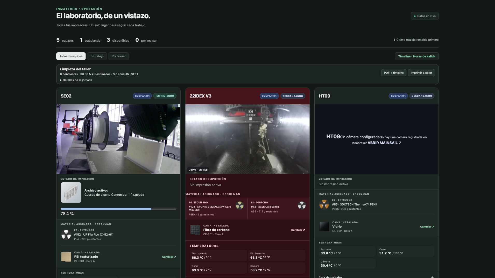
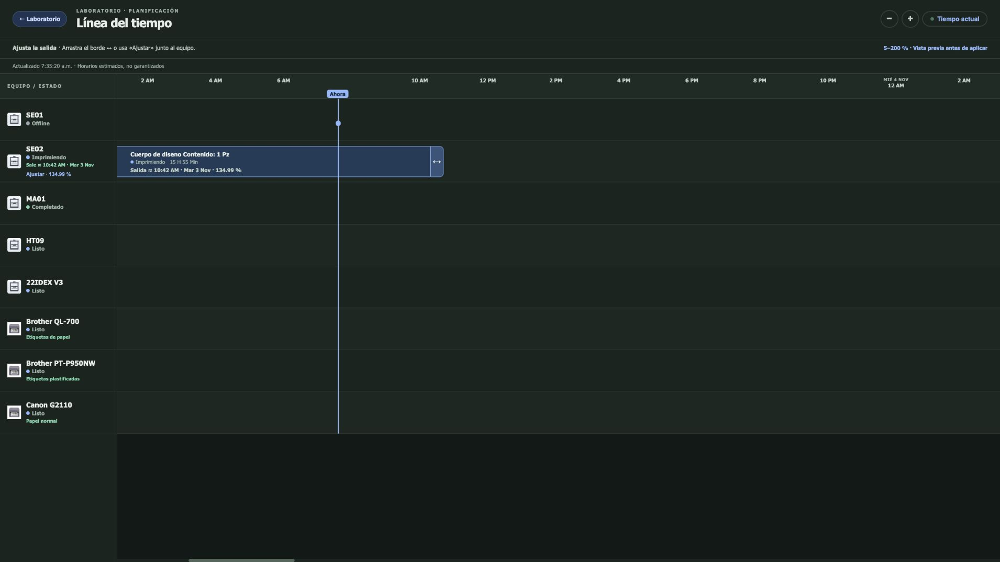
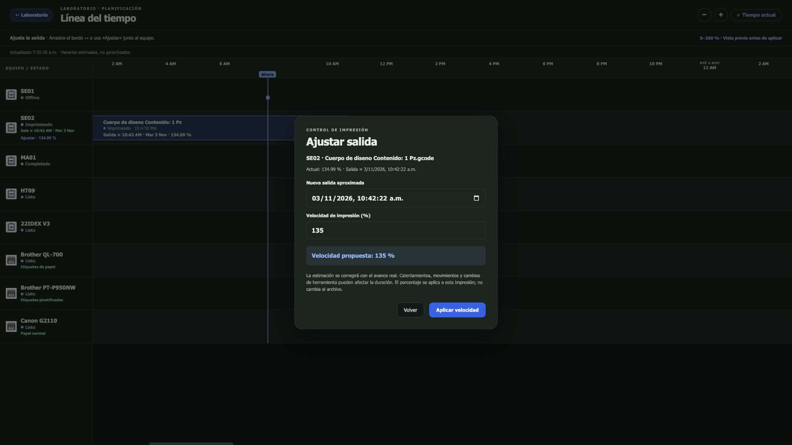

# LabDashboard by Inmateriis

**Impresoras, bobinas, camas físicas y horas de salida en un mismo panel.**

Código del dashboard que usamos en el laboratorio, publicado para revisión y colaboración. Integra equipos Klipper/Moonraker, una IDEX con Duet mediante un puente local, Spoolman, [PlateLink](https://github.com/ANGELESCALONABUENO/PlateLink) y PrintHost.



## Línea del tiempo

Historial, trabajos actuales, colas y salida aproximada por impresora. El borde derecho de una impresión activa puede arrastrarse para proponer otra hora de salida; también hay un botón **Ajustar** y una entrada directa de porcentaje. La vista previa requiere pulsar **Aplicar velocidad** antes de enviar el cambio.





- Rango permitido: **5–200 %**, validado también en el servidor.
- Calcula el porcentaje sobre el tiempo **restante**, no sobre toda la impresión.
- Consulta firmada con vigencia de 120 segundos y comprobación del archivo/trabajo y velocidad actuales.
- Envía `M220` solo por petición del operador; confirma el porcentaje leído cuando el equipo responde.
- Evita reenviar una solicitud duplicada y no repite automáticamente un envío incierto.
- Recalcula las estimaciones con el progreso real; no promete una hora exacta.
- IDEX: un cambio de herramienta en multicolor puede restablecer el porcentaje. No hay un proceso que lo fuerce de nuevo automáticamente.
- PrintHost muestra tres equipos: QL-700, PT-P950NW y Canon G2110. Los registros sin duración no reciben una duración inventada.

## Qué se publica

Es una **instantánea de integración del laboratorio**, no un instalador universal. Incluye el frontend y los adaptadores Python del dashboard. No contiene bases de datos, contraseñas, tokens, G-code ni configuración de red real. Las IP de ejemplo `192.0.2.*` pertenecen al rango de documentación.

Los paneles individuales de IDEX, el broker de etiquetas térmicas, el servicio de impresión compartida, los adaptadores UPS y Spoolman son servicios externos; no se instalan con este repositorio. Las funciones correspondientes requieren esos servicios o adaptar sus endpoints. Las macros que aparecen en la interfaz son específicas del equipo y se deben revisar antes de habilitar controles.

## Preparación

Python 3.10+, en un servidor de una red privada:

```sh
python3 -m venv .venv
. .venv/bin/activate
pip install -r requirements.txt
cp examples/endpoints.example.json endpoints.local.json
# Edita los hosts según examples/endpoint-roles.json.
python configure.py --config endpoints.local.json --output runtime
cd runtime
python core-dashboard-proxy.py
```

Abre http://127.0.0.1:8788/. El servidor escucha en loopback por defecto. Para compartirlo, configura deliberadamente `LAB_BIND` con una interfaz privada y controla el acceso en tu LAN/VPN. Este dashboard no proporciona cuentas de usuario ni autorización por operador: no debe exponerse directamente a Internet.

Los POST de control están deshabilitados en la copia pública por defecto. Después de comprobar las impresoras, rutas y macros en tu red, usa `LAB_ENABLE_COMMANDS=1` para habilitarlos. El código publicado no cambia la configuración del dashboard que ya está funcionando en el laboratorio.

Las consultas de material no descuentan consumo: se conservan los mecanismos de Moonraker/Duet existentes. El selector de placas registra una asignación física declarada por el operador, no detectada por sensores.

## Puentes y puertos de referencia

| Servicio | Puerto usado por la integración |
| --- | --- |
| Dashboard | 8788 |
| Moonraker | 7125 / proxy web 80 |
| Panel/puente IDEX | 8811 |
| PlateLink | 8812 |
| Spoolman | 7912 |
| PrintHost: etiquetas de trabajo | 8120 |
| PrintHost: inventario de dispositivos | 8132 |
| Compartir impresión | 8790 |

El adaptador `/devices` requiere un token privado en `~/.timeline-printhost-token`; no se distribuye. El puente de PrintHost debe proporcionar ese endpoint autenticado para consultar sus tres dispositivos. El adaptador de etiquetas plastificadas de PlateLink es independiente.

## Pruebas y estado

```sh
PYTHONPATH=. python -m unittest discover -s tests -v
```

Las pruebas automatizadas usan dobles de red, sin enviar comandos a impresoras. En SE02 se verificó en impresión real un cambio de **134,99 a 134 %**, lectura de confirmación y restauración a **134,99 %**; también se rechazaron 4 y 201 %. Se comprobó la edición de la vista previa y su cancelación sin cambios adicionales. La calidad física de la pieza no se evaluó mediante estas pruebas.

Próximas contribuciones útiles: configuración declarativa completa, adaptadores independientes, pruebas de interacción del arrastre, estimación de tiempo más estable y tratamiento de cambios de herramienta IDEX.

## Licencia

Código original: AGPL-3.0-only. Consulta [avisos de terceros](THIRD_PARTY_NOTICES.md) para las imágenes y referencias.
